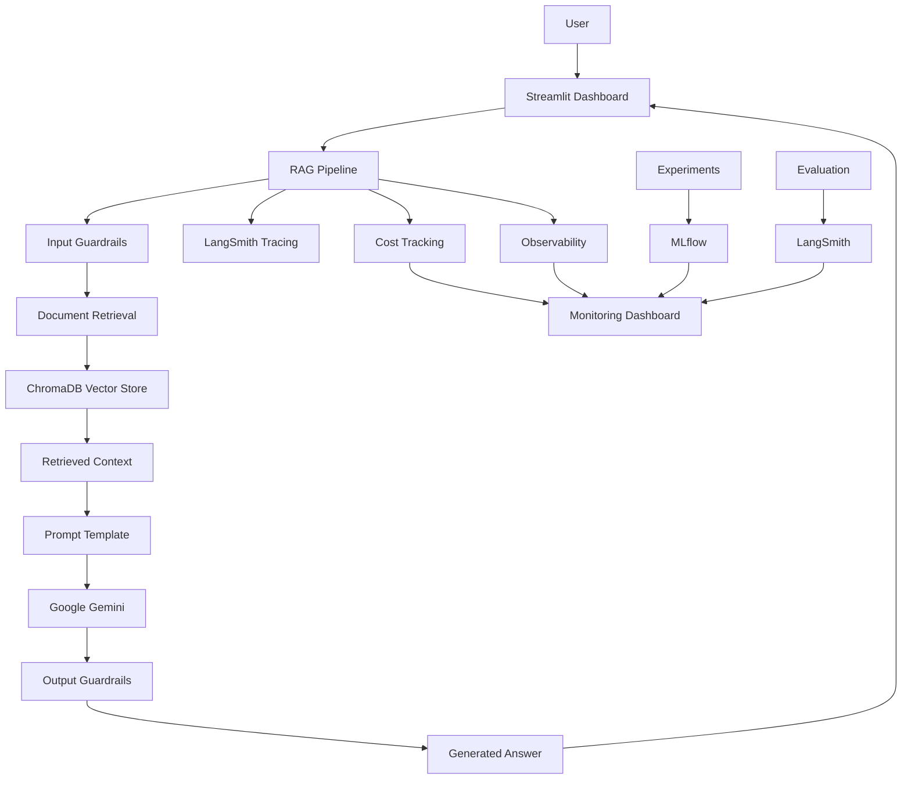

# 🤖 OpsRAG — Production RAG & LLMOps Monitoring Platform

**An integrated Retrieval-Augmented Generation (RAG) application with evaluation, prompt versioning, guardrails, experiment tracking, cost tracking, and observability.**

OpsRAG demonstrates how to build and monitor an LLM-powered document assistant using modern LLMOps practices. It combines document-based question answering with operational monitoring and experimentation in a single platform.

---

## 🚀 Overview

Traditional RAG applications focus primarily on retrieving documents and generating answers. OpsRAG goes further by incorporating the operational components required to evaluate, monitor, and improve an LLM application.

With OpsRAG, users can:

- Ask questions about uploaded company policy documents.
- Retrieve relevant document chunks using vector similarity search.
- Generate context-grounded answers using Google Gemini.
- Trace LLM execution using LangSmith.
- Manage and version prompts through LangSmith Prompt Hub.
- Evaluate answer quality using custom evaluation metrics.
- Apply input, retrieval, and output guardrails.
- Track token consumption and estimated API costs.
- Compare different RAG configurations using MLflow.
- Monitor application requests, failures, latency, and usage through a Streamlit dashboard.

---

## 🏗️ Architecture



---

## 🛠️ Tech Stack

| Category | Technology |
|---|---|
| Programming Language | Python |
| LLM | Google Gemini |
| RAG Framework | LangChain |
| Embeddings | Sentence Transformers |
| Embedding Model | all-MiniLM-L6-v2 |
| Vector Database | ChromaDB |
| LLM Tracing | LangSmith |
| Prompt Management | LangSmith Prompt Hub |
| Evaluation | Custom Evaluation + LangSmith |
| Experiment Tracking | MLflow |
| Guardrails | Custom Python Validation |
| Cost Tracking | Token Usage Monitoring |
| Dashboard | Streamlit |
| PDF Processing | PyPDF |

---

## ✨ Key Features

### 1. Retrieval-Augmented Generation

- Loads PDF and TXT documents.
- Splits documents into smaller chunks.
- Generates local embeddings.
- Stores document vectors in ChromaDB.
- Retrieves relevant chunks for user queries.
- Generates answers using Gemini based on retrieved context.

### 2. LangSmith Integration

Implements LLM tracing to monitor the execution of the RAG pipeline.

Traced components include:
- Document retrieval
- Answer generation
- Complete RAG pipeline

Provides visibility into execution flow, inputs, outputs, and nested operations.

### 3. Prompt Versioning

Uses LangSmith Prompt Hub to publish and retrieve versioned prompts.

Implemented:
- Prompt V1
- Improved Prompt V2
- Versioned prompt publishing
- Retrieval of published prompt versions

### 4. Evaluation

Built an evaluation workflow using an eight-case dataset.

Implemented metrics:

| Metric | Purpose |
|---|---|
| Correctness | Checks generated answers against expected answers |
| Answer Relevance | Measures relevance between questions and answers |
| Faithfulness Similarity Proxy | Estimates similarity between answers and retrieved context |
| Retrieval Similarity Proxy | Estimates similarity between expected answers and retrieved context |

**Note:** The faithfulness and retrieval metrics are embedding-similarity proxies, not claim-level factual verification.

### 5. Guardrails

Implements basic application-level safety checks.

- Input validation
- Prompt injection detection
- Retrieved document validation
- Output validation
- Empty and excessively long input handling
- Suspicious document filtering

Includes a test suite with 13 guardrail test cases.

### 6. Cost Tracking

Tracks:
- Input tokens
- Output tokens
- Total token consumption
- Estimated API costs
- Cost per request

Stores usage records in JSONL format.

API pricing is configurable through environment variables.

### 7. Experiment Tracking

Uses MLflow to track and compare RAG configurations.

Experiments record:
- Model configuration
- Embedding model
- Chunk size and overlap
- Retrieval K
- Number of indexed chunks
- Evaluation metrics
- Latency
- Token consumption
- Estimated cost

### 8. Observability

Implements structured application event logging.

Monitors:
- Total requests
- Successful requests
- Rejected requests
- Failed requests
- Retrieval latency
- Generation latency
- Total request latency

Stores events in JSONL format.

### 9. Integrated Dashboard

The Streamlit dashboard provides six sections:

| Section | Functionality |
|---|---|
| RAG Assistant | Interact with document-based assistant |
| Overview | Request analytics and performance |
| Cost Analytics | Token usage and estimated costs |
| Evaluation | Evaluation metric comparisons |
| Experiments | Baseline and experiment comparison |
| Observability | Application event monitoring |

---

## 📊 Controlled Experiment Results

Two RAG configurations were evaluated using the same eight test cases.

| Metric | Baseline RAG | Experiment B |
|---|---:|---:|
| Chunk Size | 500 | 800 |
| Chunk Overlap | 50 | 100 |
| Retrieval K | 3 | 5 |
| Indexed Chunks | 16 | 9 |
| Correctness | 1.00 | 1.00 |
| Answer Relevance | 0.9033 | 0.9033 |
| Faithfulness Proxy | 0.4653 | 0.4257 |
| Retrieval Proxy | 0.4300 | 0.3898 |
| Average Latency | 15.15s | 6.86s |
| Input Tokens | 3,404 | 5,979 |
| Output Tokens | 98 | 98 |
| Total Tokens | 3,502 | 6,077 |

### Observations

- Both configurations achieved 1.00 correctness on the eight evaluated cases.
- Experiment B used approximately 75.7% more input tokens.
- Experiment B recorded lower average latency in this particular run.
- Baseline recorded higher faithfulness and retrieval similarity proxies.

These results represent one recorded run per configuration. They do not establish statistically significant performance differences.

---

## 📁 Project Structure

```text
OpsRAG/
│
├── backend/
│   ├── __init__.py
│   ├── main.py
│   ├── rag.py
│   ├── config.py
│   ├── publish_prompts.py
│   ├── check_prompt.py
│   ├── create_dataset.py
│   ├── evaluate.py
│   ├── guardrails.py
│   ├── test_guardrails.py
│   ├── cost_tracker.py
│   ├── run_experiment.py
│   └── observability.py
│
├── dashboard/
│   ├── __init__.py
│   └── app.py
│
├── documents/
│   ├── company_policy.txt
│   ├── hr_policy.txt
│   ├── reimbursement.txt
│   ├── security_policy.txt
│   └── onboarding.txt
│
├── evaluation/
│   └── test_cases.json
│
├── experiments/
│   ├── controlled_comparison.json
│   ├── cost_logs.jsonl
│   └── observability.jsonl
│
├── .env
├── .gitignore
└── README.md
```

Some experiment logs and database files are generated at runtime.

---


## 🔐 Security Considerations

OpsRAG includes baseline application-level security checks.

Current protections include:
- Prompt injection pattern detection.
- Input validation.
- Retrieved document filtering.
- Output validation.
- Protection against instructions embedded in retrieved documents.

These checks are heuristic-based and are not a complete security solution.

Production deployment would require additional protections, including stronger authorization, rate limiting, secrets management, privacy controls, and more robust factual-grounding verification.

---

## ⚠️ Current Limitations

- Evaluation uses a relatively small dataset of eight test cases.
- Faithfulness and retrieval metrics are similarity proxies.
- Guardrails use heuristic and regex-based checks.
- Monetary cost estimates depend on configured model pricing.
- Experiment latency results require repeated runs for reliable comparison.
- Current implementation is designed as a local learning and demonstration platform, not a fully production-hardened service.

---

## 🔮 Future Improvements

- Claim-level faithfulness evaluation.
- Larger and more diverse evaluation datasets.
- Advanced prompt injection detection.
- PII detection and redaction.
- User authentication and role-based access.
- Automated regression evaluation.
- Historical experiment trend analysis.
- Deployment with production-grade monitoring and alerting.

---

## 🎯 Project Objective

The objective of OpsRAG is to demonstrate that building an LLM application involves more than connecting an LLM to a vector database.

A reliable LLM application also requires evaluation, monitoring, prompt management, safety controls, cost awareness, and continuous experimentation.

**OpsRAG brings these LLMOps capabilities together in one integrated RAG platform.**

---

## 👨‍💻 Author

**Inderjot Singh**

B.Tech Computer Science & Engineering (AI & ML)

- GitHub: [InderjotSingh17](https://github.com/InderjotSingh17)
- LinkedIn: [Connect with me](https://www.linkedin.com/in/inderjot-singh-0471a6237)

---

⭐ If you find this project useful, consider giving the repository a star.
